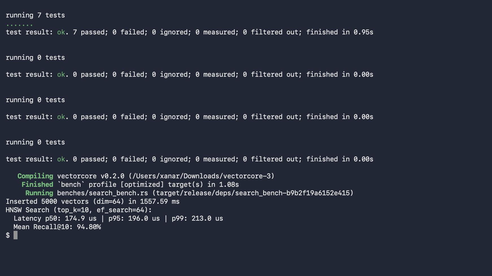

<div align="center">
  <h1>VectorCore</h1>
  <p><strong>A zero-dependency vector and hybrid search engine in pure Rust.</strong></p>
  <p>Version 0.2.0 · nowii-core · HNSW + BM25 + RRF · WAL + Snapshot</p>
</div>

<p align="center">
  <a href="./LICENSE"></a>
  
  
  
  
  
</p>

<p align="center">
  <a href="#overview">Overview</a> |
  <a href="#preview">Preview</a> |
  <a href="#benchmarks">Benchmarks</a> |
  <a href="#key-features">Features</a> |
  <a href="#quick-start">Quick Start</a> |
  <a href="#http-api">HTTP API</a> |
  <a href="#storage--persistence">Storage</a> |
  <a href="#development">Development</a> |
  <a href="#contact--support">Contact</a>
</p>

---

## Overview

Most vector and search engines pull in heavy external crates, complex runtimes, or bloated abstractions before you can even test a query. **VectorCore takes a zero-dependency, systems-first approach:** it implements dense vector indexing, sparse lexical ranking, hybrid fusion, crash-safe logging, binary snapshots, and an HTTP/1.1 JSON server from scratch using only the Rust standard library.

VectorCore combines an **HNSW** approximate nearest neighbor graph with an **Okapi BM25** inverted index and merges rankings via **Reciprocal Rank Fusion (RRF)**. Every write can be durably appended to a **CRC32-verified Write-Ahead Log (`VCW1`)** and persisted as a full binary snapshot (`VCS1`).

```text
VectorCore
  ├── HNSW Graph Index (Cosine, Euclidean, Dot Product)
  ├── BM25 Inverted Index & Tokenizer
  ├── Reciprocal Rank Fusion (RRF) Hybrid Query Engine
  ├── Crash-Safe WAL (VCW1 + CRC32 IEEE + fsync)
  ├── Binary Snapshots (VCS1 + CRC32 IEEE)
  └── Zero-Dependency HTTP/1.1 Server & CLI Benchmark
```

VectorCore is written in pure Rust (`edition = "2021"`) with no runtime dependencies in `Cargo.toml`.

---

## Preview

<p align="center">
  
</p>

> **Sub-millisecond Vector Search:** 5,000 vectors indexed with `p50: 174.9 us` median query latency and `94.80%` recall on Apple Silicon.

---

## Benchmarks

Measured on Apple Silicon (`release` / `bench` profile, `5,000` vectors, `dim=64`, `top_k=10`, `ef_search=64`):

| Metric | Result | Notes |
| :--- | :--- | :--- |
| **Ingestion (5,000 vectors, dim=64)** | `1557.59 ms` | Full HNSW graph construction |
| **Latency p50** | `174.9 us` (`0.17 ms`) | Sub-millisecond median query latency |
| **Latency p95** | `196.0 us` (`0.19 ms`) | 95th percentile search latency |
| **Latency p99** | `213.0 us` (`0.21 ms`) | Tail latency under 0.25 ms |
| **Mean Recall@10** | `94.80%` | Measured against exact brute-force search |

> **Run it yourself:** `cargo bench --bench search_bench`

---

## Key Features

- **Zero External Dependencies:** Built purely on Rust's standard library (`std`) with no third-party crates required for core indexing, storage, JSON parsing, or HTTP serving.
- **HNSW Graph (`src/index/hnsw.rs`):** Multi-layer Hierarchical Navigable Small World index with configurable `m`, `ef_construction`, and `ef_search`, supporting `Cosine`, `Euclidean`, and `DotProduct` metrics plus exact brute-force search for recall verification.
- **BM25 Inverted Index (`src/index/inverted.rs`):** Case-insensitive alphanumeric tokenization, term frequency tracking, document length normalization, and Okapi BM25 ranking (`k1`, `b`).
- **Hybrid RRF Search (`src/query/hybrid.rs`):** Combines dense vector candidates and sparse BM25 lexical matches using Reciprocal Rank Fusion (`rrf_k`, configurable vector and BM25 weights).
- **Write-Ahead Log (`src/storage/wal.rs`):** Append-only binary log (`VCW1`) with payload length, CRC32 IEEE checksum, `sync_data` (`fsync`), and safe replay that stops cleanly at corrupt or truncated tail records.
- **Binary Snapshots (`src/storage/snapshot.rs`):** Full state serialization (`VCS1`) with CRC32 IEEE integrity verification covering documents, HNSW nodes/neighbors/entry-point/max-level/RNG state, and BM25 structures.
- **HTTP/1.1 JSON Server (`src/server/http.rs`):** Lightweight `TcpListener` server supporting document ingestion, hybrid search, health checks, and snapshot save/load endpoints.

---

## Quick Start

### Requirements

- **Compiler:** Rust toolchain (`cargo` and `rustc`, Rust 2021 edition).
- **OS:** macOS, Linux, or Windows.

### 1. Clone and enter the repository

```bash
git clone https://github.com/nowii-core/vectorcore.git
cd vectorcore
```

### 2. Run tests, example, and benchmark

```bash
cargo test
cargo run --release --example semantic_search
cargo bench --bench search_bench
```

### 3. Start the HTTP server

```bash
cargo run --release --bin vectorcore_server
```

By default, the server listens on:

```text
http://127.0.0.1:8080
```

---

## HTTP API

Once `vectorcore_server` is running on `127.0.0.1:8080`, you can interact with it using `curl`:

### Health check

```bash
curl -s http://127.0.0.1:8080/health
```

### Ingest a document (WAL-backed)

```bash
curl -s -X POST http://127.0.0.1:8080/ingest \
  -H "Content-Type: application/json" \
  -d '{"id":1,"text":"Rust HNSW hybrid search engine","vector":[0.9,0.1,0.0]}'
```

### Hybrid search (`query` + `vector` + `top_k`)

```bash
curl -s -X POST http://127.0.0.1:8080/search \
  -H "Content-Type: application/json" \
  -d '{"query":"Rust HNSW","vector":[0.9,0.1,0.0],"top_k":3}'
```

### Save & load snapshots

```bash
curl -s -X POST http://127.0.0.1:8080/snapshot/save
curl -s -X POST http://127.0.0.1:8080/snapshot/load
```

---

## Storage & Persistence

VectorCore separates append-only durability from full index snapshots:

- **WAL (`vectorcore.wal`, magic `VCW1`):** Appends each ingested document with a CRC32 IEEE checksum and flushes with `sync_data()`. On startup, `vectorcore_server` replays entries not yet present in the loaded snapshot.
- **Snapshot (`vectorcore.vcsnap`, magic `VCS1`):** Writes a single CRC32-protected binary image of the entire `HybridSearchEngine` state for fast reloads without replaying or rebuilding from scratch.

---

## Development

### Run the test suite

```bash
cargo test
```

### Project Structure

```text
Cargo.toml                  Package manifest (zero external dependencies)
benches/
  search_bench.rs           Latency (p50/p95/p99) and Recall@10 benchmark
examples/
  semantic_search.rs        End-to-end WAL, snapshot, and hybrid search demo
src/
  lib.rs                    Core types (Document, SearchHit) and JSON helpers
  index/
    distance.rs             Cosine, L2, dot product, and vector normalization
    hnsw.rs                 Multi-layer HNSW graph and brute-force baseline
    inverted.rs             Tokenizer and Okapi BM25 inverted index
  query/
    hybrid.rs               Reciprocal Rank Fusion (RRF) search engine
  storage/
    wal.rs                  CRC32 write-ahead log and crash recovery
    snapshot.rs             CRC32 binary snapshot save/load
  server/
    http.rs                 HTTP/1.1 server and JSON endpoint handlers
  bin/
    vectorcore_server.rs    Server binary with snapshot + WAL recovery
    vectorcore_bench.rs     Benchmark helper binary
```

---

## Contact & Support

- **Maintainer:** [@nowii-core](https://github.com/nowii-core)
- **Repository:** [github.com/nowii-core/vectorcore](https://github.com/nowii-core/vectorcore)
- **Issues & PRs:** Open an issue or pull request directly in the repository.

---

<div align="center">
  <sub>Developed by <b>nowii-core</b></sub>
</div>
